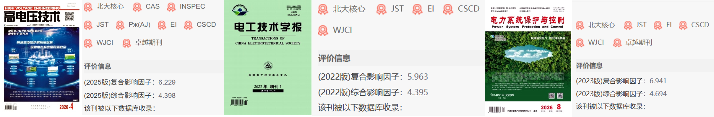
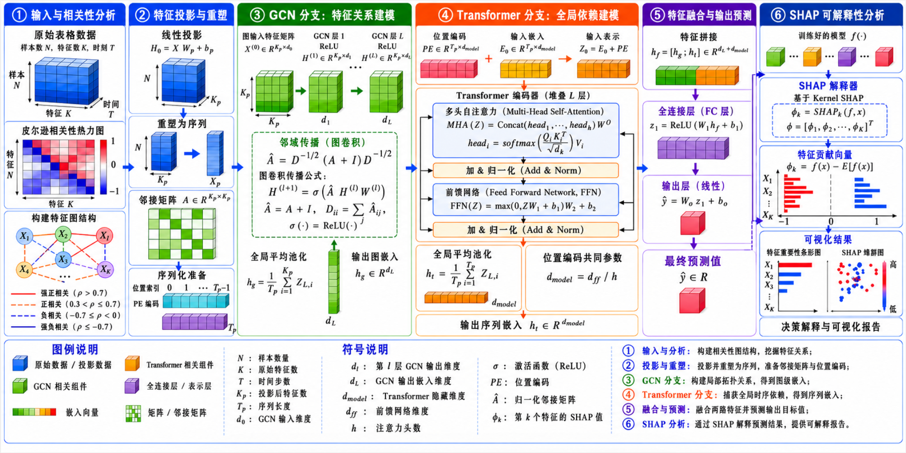
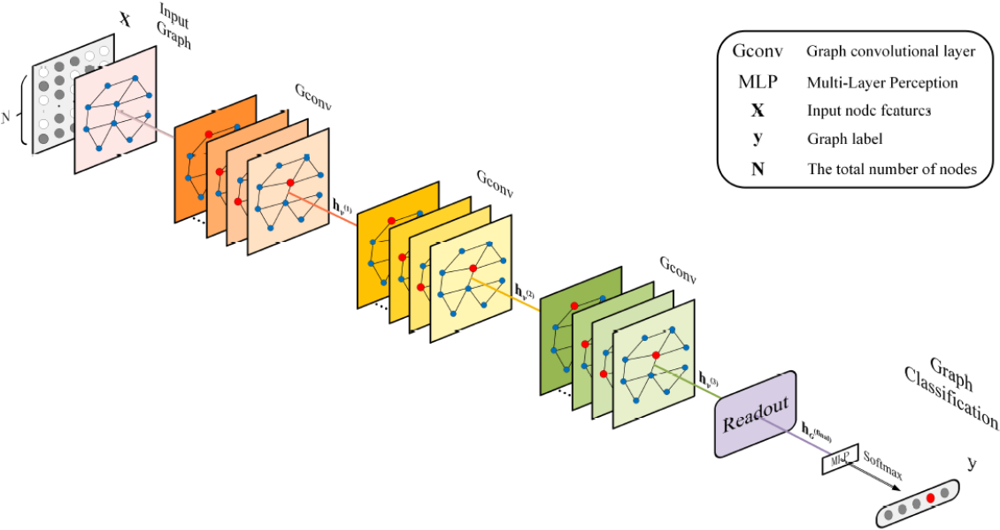
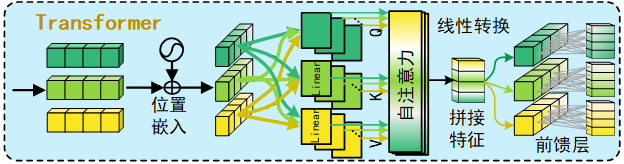
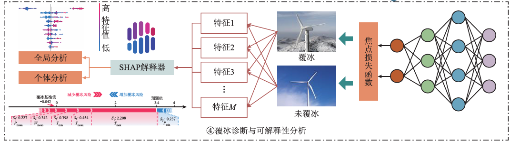
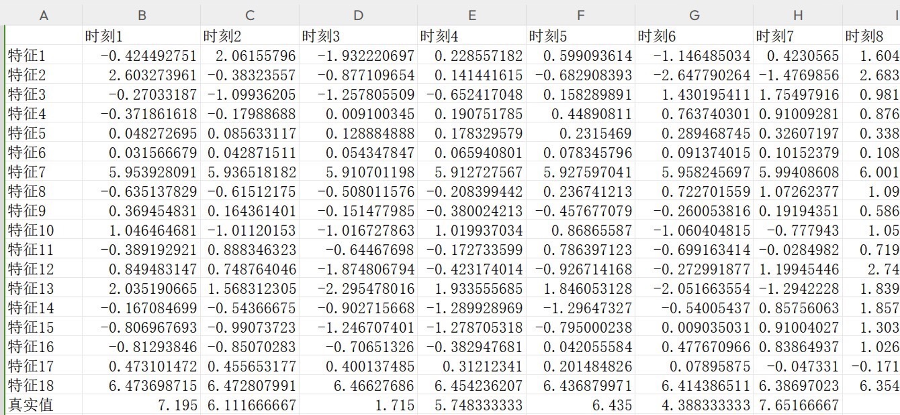
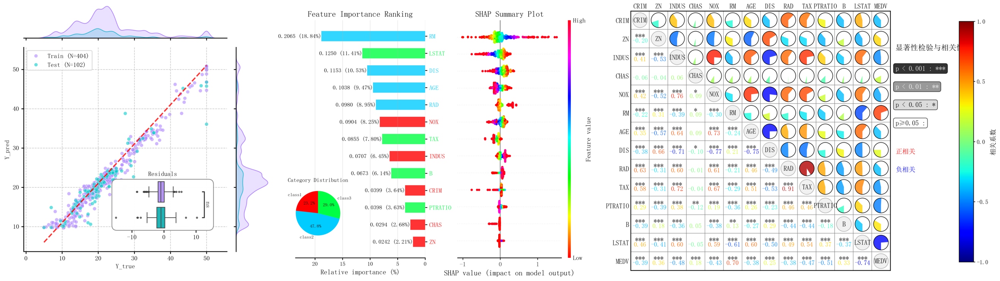
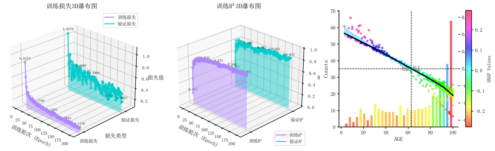
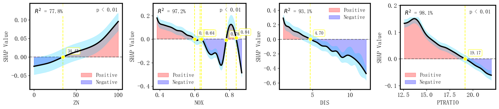
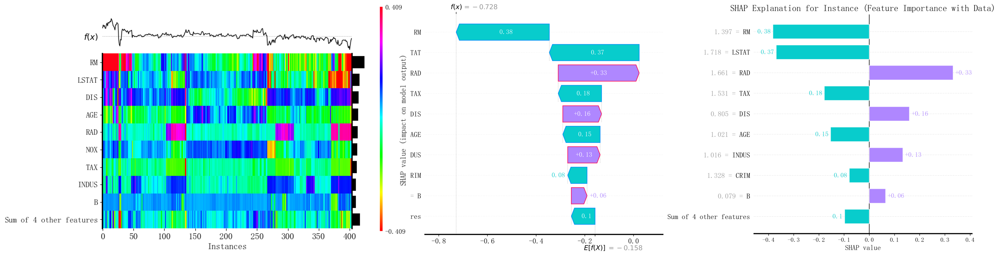

# Explainable Universal Multivariate Regression Prediction Model Based on GraphEnFormer, one-click operation! Results are directly outputted!

Applicable Platform: Python 3.11.9 (PyTorch 2.5.0)
References:
1. Wang Kangkang, Mei Shengwei, Wei Wei, et al. Fast transient security assessment method based on graph convolutional network [J]. Power System Protection and Control, 2023, 51(1): 43-51. DOI: 10.19783/j.cnki.pspc.220587
2. Dong Jun, Liu Rui, Shu Hongchun, et al. L-Transformer distributed photovoltaic short-term power generation forecasting based on BIRCH clustering [J]. High Voltage Technology, 2024, 50(9): 3883-3893. DOI: 10.13336/j.1003-6520.hve.20230809
3. Lu Yunlong, Hu Qin, Hu Ziyuan, et al. Considering sample imbalance conditions for wind turbine blade icing diagnosis and its interpretability study [J]. Electrical Technology Journal, 2025, 40(11): 3667-3679. DOI: 10.19595/j.cnki.1000-6753.tces.240795
After making predictions, many people often feel confused: even deeper networks or more complex models can't reduce the error. The problem is often not in the model itself but in the data fed into it before it gets to the prediction stage.
① In multivariate prediction tasks, features are never independent of each other. Temperature affects load, load affects electricity price, and electricity price is also linked to energy consumption behavior—these hidden relationships are the most valuable signals in the prediction results. However, traditional neural networks simply spread out all features into a single row of numbers, cutting off this interconnected network at the very beginning.
The value of Graph Convolutional Networks (GCN) lies in this: first, it establishes a graph of interrelationships between features; then, the model learns from this graph—features are no longer isolated numbers that are unrelated, but nodes with neighbors, connections, and structure.
However, GCN alone is not enough. To perform regression effectively, one needs a module capable of viewing the whole picture—this is precisely where Transformer's strength lies.
Furthermore: once the model makes accurate predictions, can you answer "why did this result occur, which feature contributed most"? This is equally crucial in engineering applications and academic publications. The answer provided by SHAP precisely addresses this.
Combining these three aspects together, we propose the following: the interpretable generalized multivariate regression prediction model based on GraphEnFormer (Graph-structured GCN enhanced Transformer interpretable SHAP regression prediction model).
Transformer models are currently the absolute hotspot in the field of regression prediction, while graph neural networks (GCN) are emerging tools for modeling feature relationships. However, there is a lack of systematic research on the joint application of both in the generalized multivariate regression domain, let alone incorporating SHAP for improved interpretability!
The combination of feature graph modeling + Transformer regression + SHAP interpretability is bound to be an innovative direction for publication, with extremely scarce literature on this topic! Furthermore, the complete framework combining GCN feature graph + Transformer + SHAP + Pearson correlation visualization + a seven-dimensional evaluation system has never been systematically proposed before, and can be said to have a high success rate when submitted!
Literature interpretation one:
How does GCN "understand" the relationship graph? "A Fast Transient Safety Assessment Method Based on Graph Convolutional Networks"
The core idea: Directly model the power grid topology as a graph (buses = nodes, branches = edges), where GCN aggregates the electrical state features of each bus neighborhood layer by layer along the graph structure (active power, reactive power, voltage, phase angle), automatically learning the spatial dependencies between nodes. The final output is a continuous prediction of transient safety margins. This paradigm is extended from the power grid topology graph to the feature correlation graph—similarly "build the graph first (KNN Pearson), then let GCN aggregate along the graph". This allows the model to encode the inter-variable dependencies at the initial step, fundamentally solving the problem of "features being treated as isolated numbers".
Literature interpretation two
How does the Transformer capture "global dependencies"? "Based on BIRCH clustering for L-Transformer distributed photovoltaic short-term power generation forecasting"
The core idea: Proposes the L-Transformer model: First, use BIRCH hierarchical clustering to group distributed photovoltaic sites according to their output mode, eliminating heterogeneous noise; then, construct L-Transformers (Local Transformer) for each group, replacing global attention with local multi-head self-attention, while retaining temporal local dependencies, significantly reducing computational costs; finally, completes continuous value regression predictions for short-term power generation in various real-world datasets, significantly outperforming models like LSTM and CNN. After extracting graph structure features with GCN, this model also enters a Transformer encoder for global modeling—multi-head attention automatically quantifies which feature combinations contribute most to prediction.
Literature interpretation three
How does SHAP make black-box models "speak"? "Considering sample imbalance conditions for wind turbine blade icing diagnosis and its interpretability study"
The core idea: To address the severe imbalance issue of ice accretion on wind turbine blades, firstly, SMOTE oversampling and undersampling strategies are used to balance the data distribution. Then, a machine learning classification model is trained. Subsequently, SHAP (SHapley Additive exPlanations) causal inference theory is introduced to quantify the feature importance of each ice accretion influencing factor (temperature, humidity, wind speed, pressure, etc.). This not only outputs "what the model predicts" but also answers "which features contribute most and how much," significantly enhancing the practical value of engineering. In this paper, after completing multivariate regression with GCN-Transformer, Shapley values for each feature are calculated - not only can global feature importance be ranked, but also trace back "which variable contributed most to this prediction" for each sample, transforming black boxes into verifiable scientific conclusions, perfectly aligning with top journal requirements for explainable models.
Innovative breakdown:
Innovation 1: Feature-related graph-driven GCN modeling breaks through the limitation of traditional regression models treating features as independent inputs by introducing a feature-related graph structure. The GCN aggregates neighbor node information on the graph, naturally perceiving the dependencies and synergies between features, applicable to any multivariate dataset.
Innovation 2: GCN + Transformer generalized regression framework combines graph convolutional feature extraction with Transformer global attention modeling to construct a unified framework for multivariate regression across various domains. This combination is almost unseen in existing literature, demonstrating high innovation value.
Innovation 3: Multi-head self-attention automatically quantifies feature weights. The Transformer's multi-head self-attention mechanism automatically assigns different weights to different features during regression, focusing on features that contribute more to predictions, addressing the shortcoming of traditional methods in dynamically perceiving feature importance.
Innovation 4: SHAP deep interpretability addresses the strict calculation of Shapley values in deep learning models, quantifying the marginal contribution of each feature to each sample prediction from a game theory perspective, transforming black box predictions into verifiable scientific conclusions.
Innovation 5: Enhanced Pearson Correlation Matrix Visualization - Design of an enhanced correlation matrix chart with p-value significance tests - The upper triangle pie chart displays the strength of correlation, while the lower triangle shows numerical values. Color mapping distinguishes positive and negative correlations, balancing academic rigor with readability.
Data format:
Each line: Input feature
Previous N columns: a sample
Last column: Regression target value (the value to be predicted)
Program result graph
One-click operation, automatically generate all 7 types of charts, directly use for thesis graphs!
① Pearson correlation coefficient matrix chart (pie chart + numerical version, including p-value significance annotations)

## Images

<!-- PAYMENT_BLOCK -->

## Get this dataset

- Payment link (Stripe): [Buy now](https://buy.stripe.com/3cs8yP7sY87d0vu9AB)
- Payment QR code: 

<!-- /PAYMENT_BLOCK -->
